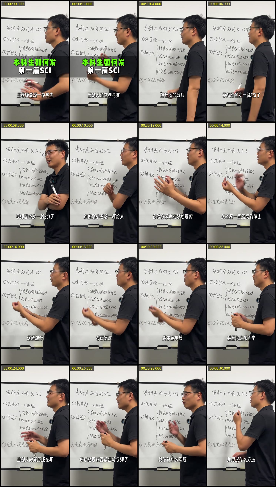

# 视频之眼（dsh-video-eyes）

让纯文本模型看懂视频。**独立工作**，不依赖任何其他视觉插件。



## 仓库里有两个东西

| 形态 | 位置 | 给谁用 |
|---|---|---|
| **DSH 插件** | 仓库根目录（`package.json` / `index.js` / `client.js` / `cordis.patch.yml`） | DeepSeek Harness：注册 `read_video` / `read_video_transcript`，外加输入框上方的间隔滑块 |
| **通用 skill** | `skills/video-eyes/` | 任何 agent（Claude Code / Codex / Cursor / 自建脚本）：纯 Node + ffmpeg 的命令行实现，无第三方依赖 |

装插件：

```sh
dsh plugin --profile web add github:<owner>/dsh-video-eyes
```

用 skill（复制到任意 agent 的技能目录，或在 DSH 里放到工作区 `.dsh/skills/`）：

```sh
cp -r skills/video-eyes <你的工作区>/.dsh/skills/
node <你的工作区>/.dsh/skills/video-eyes/scripts/video-eyes.mjs run demo.mp4 --interval 0.5
```

两者的抽帧与转写逻辑一致，产物格式也一致；插件多一个 `describe`（自己调视觉模型描述画面）。

## 工具

| 工具 | 说明 |
|---|---|
| `read_video` | 抽帧 → 烧入时间码 → 拼图 → 提取音轨 → 转写 → **自行调用视觉模型逐页描述** |
| `read_video_transcript` | 按 record id 取回完整转写与自动纪要 |

两种输入都接受：

- **视频**：抽帧拼图 + 音轨转写 + 逐页描述
- **纯音频**（无视频流）：自动跳过抽帧，只做转写，返回 `hasVideo: false`、`sheetCount: 0`

## 界面滑块：抽帧间隔

输入框上方有一条滑轨（`conversation.input.dock`），范围 0.1–10 秒：

- 拖动即生效，无需重新发消息；下一次 `read_video` 会用它作为默认 `interval`
- 显示格式 `0.5s`；不是默认值时会额外出现「恢复默认」按钮
- 值存在 Host 进程内存中，重启回落配置里的 `defaultInterval`

通信走一个本地路由，不碰任何第三方服务：

| 方法 | 路径 | 作用 |
|---|---|---|
| `GET` | `/_dsh/video-eyes/interval` | 读当前值（含 min/max/configured/runtime） |
| `POST` | `/_dsh/video-eyes/interval` | 设值；`{"interval": 0}` 或空值表示恢复默认 |

Host 侧只是把值存进一个模块变量，工具执行时按 `args.interval ?? 运行时值 ?? 配置默认` 取值 —— 显式参数永远优先。

## 为什么工具名不叫 `vision_*`

这是为了**避免冲突**，不是随意命名。

`dsh-vision-router` 会包装 `tools.register`，把所有以 `vision_` 开头的工具**接管为自己的**：

```js
// dsh-vision-router/lib/session-vision-mode-boundary.js
if (!definition.name.startsWith('vision_') || typeof definition.execute !== 'function') {
  return register.call(target, definition, ...rest)   // 不管
}
// 否则：打上 VISION_ROUTER_TOOL_OWNER 标记、加入 owned 集合
```

后果是，当一个工具被它认领后：

1. 在它的「Vision 模式」关闭时（会话模型不是它路由的画面模型），调用会抛 `visionModeDisabledError`；
2. `projectAssemblyTools` 会把这些工具**从模型可见的工具列表里整个过滤掉**。

也就是说，如果本插件叫 `vision_video`，用户只是关掉 Vision 开关，视频工具就会凭空消失，理由和视频本身毫无关系。所以本插件使用 `read_video*`，完全避开那个命名空间。

## 独立性

`describe=true`（默认）时，插件**自己**完成识图，不需要 vision-router：

1. 通过 `ctx.get('llm')` 拿到 Host 的 LLM 服务；
2. 按「显式配置 → 会话模型 → 任意声明 `image` 模态的模型」的顺序挑一个路由；
3. 用 `llm.prepareCall()` **验证**该路由确实接受图像输入（不靠名字猜）；
4. `llm.stream()` 把拼图作为 image block + 提示词发给它，收集 `text-delta`。

找不到可用视觉模型时，工具**不会失败**：`describe.status = unavailable` 并给出具体原因，拼图仍然产出，图片仍然进入对话。

## 共处规则

| 同场插件 | 是否冲突 | 说明 |
|---|---|---|
| `dsh-vision-router` | **不冲突**（改名后） | 工具名不在 `vision_` 命名空间；两者各自调用视觉模型，只多花各自的调用配额 |
| `dsh-builtin-browser` | 不冲突 | 它负责网页截图，与视频无关 |
| 任何注册 `read_video` 的插件 | **冲突** | 同名工具会注册失败（DSH 在层内拒绝重复名） |
| 任何改写 `tools.register` 的插件 | 需留意 | 若它也按前缀认领工具，可能误伤；本插件用 `read_video*`，通常安全 |

运行时如果检测到 `vision_describe` 存在（即 vision-router 在场），工具结果的头部会带一行提示，说明两者互不干涉、只是各自消耗视觉调用。

## 配置项

| 键 | 默认 | 说明 |
|---|---|---|
| `artifactDir` | `<cwd>/.dsh-video-eyes` | 产物目录。**必须可写**：Host 的 cwd 是 `C:\Users\asd\.dsh`，其 spawn 的 ffmpeg 写不进该目录，所以本 profile 配到了工作区 `_video-eyes` |
| `defaultInterval` | `0.5` | 默认抽帧间隔（秒），运行时可被 `interval` 覆盖，范围 0.1–10 |
| `columns` / `rows` | `4` / `4` | 每页网格 |
| `cellWidth` | `480` | 单格宽度；竖屏会自动压缩 |
| `maxSheets` | `4` | 最多页数 |
| `enableTranscribe` | `true` | 是否默认转写 |
| `enableDescribe` | `true` | 是否默认识图 |
| `visionProvider` / `visionModel` | 空 | 指定识图路由；空则自动挑 |
| `itingnaoApiKey` | 空 | 听脑 Key；空则读 `ITINGNAO_API_KEY`，Windows 下再读用户级环境变量 |
| `ffmpegPath` | 空 | 空则依次：`FFMPEG_PATH` → 包内 `bin/ffmpeg.exe` → PATH |

## 沙箱与权限

- 插件运行在 DSH Host 进程里，**不受会话文件沙箱约束**（沙箱只约束 agent 的 shell 工具）。
- 但 Host 能写的地方不等于 ffmpeg 子进程能写：本机实测 Host 能在 `C:\Users\asd\.dsh` 下建目录，而它 spawn 的 ffmpeg 却打不开那里的输出文件。所以 `artifactDir` 必须落在工作区。
- 代码会按 `artifactDir → cwd/.dsh-video-eyes → 系统临时目录` 顺序逐个实测写入，用第一个真正成功的，不会静默失败。
